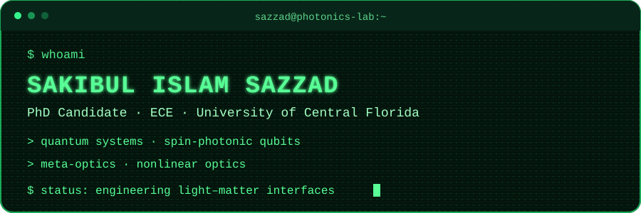

<div align="center">



[](https://www.ece.ucf.edu/Q-Lab/)
[](https://www.ece.ucf.edu/Q-Lab/)
[](https://orcid.org/0000-0001-7238-5681)
[](https://orcid.org/0000-0001-7238-5681)

</div>

```text
┌─ researcher.profile ───────────────────────────────────────────────┐
│ name       Sakibul Islam Sazzad                                   │
│ role       PhD Candidate · Electrical & Computer Engineering      │
│ location   University of Central Florida                          │
│ signal     light × matter × quantum information                   │
└────────────────────────────────────────────────────────────────────┘
```

### `> research --focus`

1. **Quantum systems** — studying and engineering light–matter interactions in the quantum regime
2. **Spin-photonic qubits** — connecting solid-state spin states with photonic interfaces
3. **Meta-optics** — controlling optical fields with compact, structured platforms
4. **Nonlinear optics** — exploring light–matter interactions beyond the linear response

### `> ls ./selected-work`

| Project | Signal |
| :-- | :-- |
| [emParticles](https://github.com/SakibulIslamSazzad/emparticles_sazzad) | Computational experiments for electromagnetic systems |
| [IBM Quantum Challenge 2020](https://github.com/SakibulIslamSazzad/IBMQuantumChallenge2020) | Quantum problem sets and notebooks |
| [QHack — Xanadu](https://github.com/SakibulIslamSazzad/qhack_xanadu) | Quantum programming experiments |
| [Qiskit Translations](https://github.com/SakibulIslamSazzad/qiskit-translations) | Community-accessible quantum documentation |

### `> cat research.conf`

```ini
[priority]
quantum_systems = primary
spin_photonic_qubits = primary
meta_optics = active
nonlinear_optics = active

[compute]
python = enabled
jupyter = enabled
qiskit = enabled
latex = enabled
```

### `> connect --open-channel`

<div align="center">

[](https://www.ece.ucf.edu/Q-Lab/)
[](https://orcid.org/0000-0001-7238-5681)
[](https://github.com/SakibulIslamSazzad)

<sub><code>signal received · curiosity remains online</code></sub>

</div>