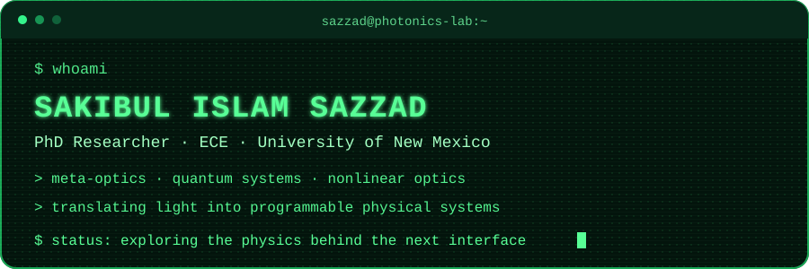

<div align="center">



[](https://sites.google.com/view/sakibulislamsazzad)
[](https://github.com/SakibulIslamSazzad)
[](https://sites.google.com/view/sakibulislamsazzad)

</div>

```text
┌─ researcher.profile ───────────────────────────────────────────────┐
│ name       Sakibul Islam Sazzad                                   │
│ role       PhD researcher · Electrical & Computer Engineering     │
│ location   University of New Mexico                               │
│ signal     light × matter × computation                           │
└────────────────────────────────────────────────────────────────────┘
```

### `> research --focus`

- **Meta-optics** — shaping wavefronts with compact, programmable structures
- **Quantum computing & physics** — exploring computation at the limits of classical intuition
- **Nonlinear optics** — studying light–matter interactions beyond the linear regime
- **Scientific computing** — turning physical models into reproducible simulations

### `> ls ./selected-work`

| Project | Signal |
| :-- | :-- |
| [IBM Quantum Challenge 2020](https://github.com/SakibulIslamSazzad/IBMQuantumChallenge2020) | Quantum problem sets and notebooks |
| [QHack — Xanadu](https://github.com/SakibulIslamSazzad/qhack_xanadu) | Quantum programming experiments |
| [Qiskit Translations](https://github.com/SakibulIslamSazzad/qiskit-translations) | Community-accessible quantum documentation |
| [Bangla in Overleaf](https://github.com/SakibulIslamSazzad/bangla_writing_in_overleaf) | Practical multilingual scientific writing |

### `> cat toolbox.conf`

```ini
[physics]
meta_optics = active
quantum_physics = active
nonlinear_optics = active

[compute]
python = enabled
jupyter = enabled
qiskit = enabled
latex = enabled
```

### `> connect --open-channel`

<div align="center">

[](https://sites.google.com/view/sakibulislamsazzad)
[](https://twitter.com/sakibul_sazzad)
[](https://github.com/SakibulIslamSazzad)

<sub><code>signal received · curiosity remains online</code></sub>

</div>